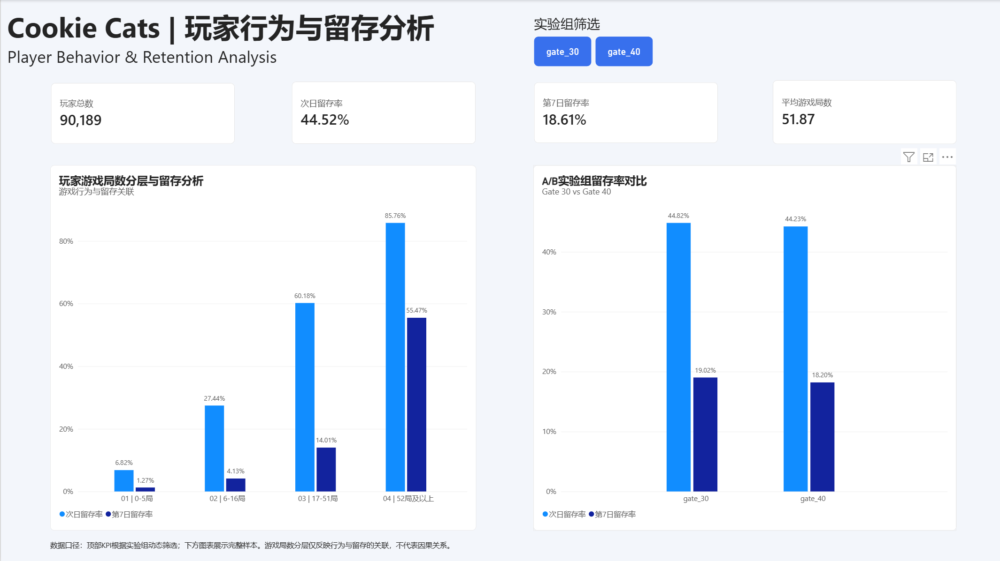
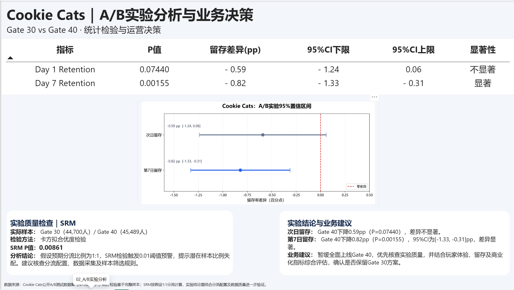

# Cookie Cats | Player Retention & A/B Testing Analysis

**Python | Pandas | SQLite | SciPy | Power BI**

An end-to-end mobile game data analytics project examining how moving a progression gate from level 30 to level 40 affects player retention.

The project combines data quality checks, SQL analysis, player behavior segmentation, statistical hypothesis testing, and interactive Power BI dashboards to support data-driven product decisions.

## 1. Dashboard Preview

### Page 1 — Player Behavior & Retention Analysis

This dashboard presents player counts, retention KPIs, game-round segmentation, and retention comparisons between the experimental groups.

### Page 2 — A/B Testing & Business Decision

This dashboard summarizes statistical significance, 95% confidence intervals, sample ratio checks, and business recommendations.

**[View the Power BI report file](outputs/Cookie_Cats_Dashboard.pbix)**

## 2. Business Problem

Cookie Cats is a mobile puzzle game in which progression gates influence the player experience.

The experiment compares two configurations:

- **Control group (`gate_30`):** Gate at level 30.
- **Treatment group (`gate_40`):** Gate moved to level 40.

**Key question:** Does moving the gate to level 40 improve player retention?

Day-7 retention is the primary evaluation metric in this analysis, with Day-1 retention used as a secondary metric.

## 3. Dataset Overview

**Source:** [Mobile Games: A/B Testing — Cookie Cats (Kaggle)](https://www.kaggle.com/yufengsui/mobile-games-ab-testing)

The dataset contains **90,189 players** and five variables:

| Variable | Description |
|---|---|
| `userid` | Unique player identifier |
| `version` | Assigned experimental group |
| `sum_gamerounds` | Total game rounds played |
| `retention_1` | Whether the player returned on Day 1 |
| `retention_7` | Whether the player returned on Day 7 |

The control group contains 44,700 players, while the treatment group contains 45,489 players.

## 4. Analysis Workflow

### Data Quality & Exploratory Analysis

- Checked missing values, duplicate player IDs, data types, and invalid game-round counts.
- Identified a highly right-skewed distribution of game rounds.
- Compared mean, median, and percentile statistics.
- Performed a sensitivity analysis to examine the influence of the largest game-round observation.

The original mean game-round counts were 52.46 for Gate 30 and 51.30 for Gate 40. After temporarily excluding the single largest observation, the values became approximately 51.34 and 51.30.

This indicates that the original difference in average game rounds was substantially influenced by one extreme observation.

### SQL-Based Player Analysis

Used SQLite within the Jupyter Notebook to perform:

- Player counts and group-level aggregations.
- Average game-round calculations.
- Day-1 and Day-7 retention calculations.
- Player behavior segmentation using `CASE WHEN`.
- Summary queries using Common Table Expressions (CTEs).

### Player Behavior Segmentation

Segmented players by their total game rounds and compared retention across activity groups.

Higher game-round segments showed higher observed retention. However, these retrospective associations do not establish that playing more rounds causes better retention.

### A/B Statistical Testing

Performed:

- Sample Ratio Mismatch (SRM) check using a chi-square goodness-of-fit test.
- Two-sided two-proportion Z-tests for Day-1 and Day-7 retention.
- Approximate 95% confidence intervals for the retention-rate differences.

The primary retention tests use all **90,189 players** without excluding extreme game-round observations.

## 5. Key Results

Retention differences are calculated as **Gate 40 − Gate 30**.

| Metric | Gate 30 | Gate 40 | Difference | P-value |
|---|---:|---:|---:|---:|
| Day-1 Retention | 44.82% | 44.23% | −0.59 pp | 0.07440 |
| Day-7 Retention | 19.02% | 18.20% | −0.82 pp | 0.00155 |

**95% confidence intervals:**

- Day-1 retention: approximately [−1.24, +0.06] percentage points.
- Day-7 retention: approximately [−1.33, −0.31] percentage points.

Under the conventional assumptions of the Z-test, the Day-1 retention difference is not statistically significant at the 5% level, whereas the Day-7 retention difference is statistically significant and negative.

### Experiment Quality Check

Assuming the intended traffic allocation was 50:50, the SRM test produced a P-value of approximately **0.00861**.

This raises a sample-allocation warning at the 1% threshold. However, the original intended allocation ratio is not verified, so the result does not establish that randomization failed.

The allocation configuration and data collection process should be checked before treating the experimental results as reliable causal evidence.

## 6. Business Recommendation

The observed results do not support a clear retention benefit from moving the gate to level 40.

Gate 40 shows a lower Day-7 retention rate, with an observed decline of approximately 0.82 percentage points.

**Recommendation:** Do not proceed directly with a full rollout of Gate 40. First verify experimental allocation and data quality, then reassess the treatment effect before making a product decision.

## 7. Tools & Skills Demonstrated

| Tool | Application |
|---|---|
| Python / Pandas / NumPy | Data cleaning, exploration, and aggregation |
| SQLite / SQL | Player metrics and segmentation queries |
| SciPy | Statistical hypothesis testing |
| Matplotlib | Exploratory and confidence interval visualizations |
| Power BI / DAX | KPI modeling and interactive dashboards |
| Jupyter Notebook | Reproducible analysis documentation |

## 8. Project Files

- [`Cookie_Cats_Analysis.ipynb`](Cookie_Cats_Analysis.ipynb) — Main analysis Notebook, including SQL and statistical testing.
- [`Dashboard_Page1.png`](Dashboard_Page1.png) — Player behavior and retention dashboard.
- [`Dashboard_Page2.png`](Dashboard_Page2.png) — A/B testing and business decision dashboard.
- [`outputs/`](outputs/) — Generated charts, summary tables, confidence interval visualization, and Power BI report.

## 9. How to Reproduce

1. Download `cookie_cats.csv` from the dataset source linked above.
2. Place the CSV file in the same directory as `Cookie_Cats_Analysis.ipynb`.
3. Install the required Python packages: `pandas`, `numpy`, `matplotlib`, `scipy`, and `notebook`.
4. Open the Notebook in Jupyter and execute the analysis cells in order.
5. Review the generated results in the `outputs/` folder.

SQLite is accessed through Python's built-in `sqlite3` module.

## 10. Limitations

- The dataset does not include detailed player-level event timelines or monetization metrics.
- Game-round segmentation is observational and should not be interpreted causally.
- The SRM warning depends on the unverified 50:50 allocation assumption.
- The results provide statistical evidence under modeling assumptions, but experimental integrity should be confirmed before rollout decisions.

---

**中文概述**

本项目基于Cookie Cats手游公开A/B实验数据，使用Python、SQL和Power BI，对90,189名玩家进行数据质量检查、游戏行为分层、留存分析及统计检验。结果显示，Gate 40组第7日留存率较Gate 30组低约0.82个百分点，常规两比例Z检验达到统计显著水平。但由于实验分流比例存在待核查的SRM预警，建议在验证实验质量后再制定正式上线决策。

*This is an independent educational portfolio project based on a publicly available dataset.*
